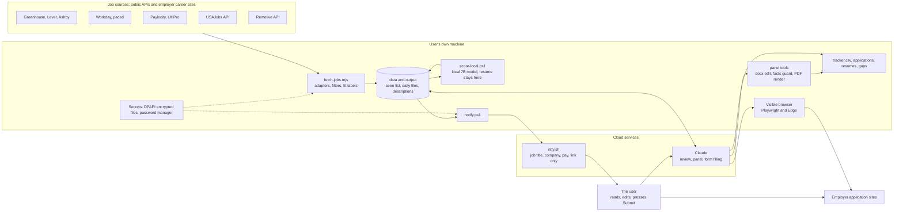
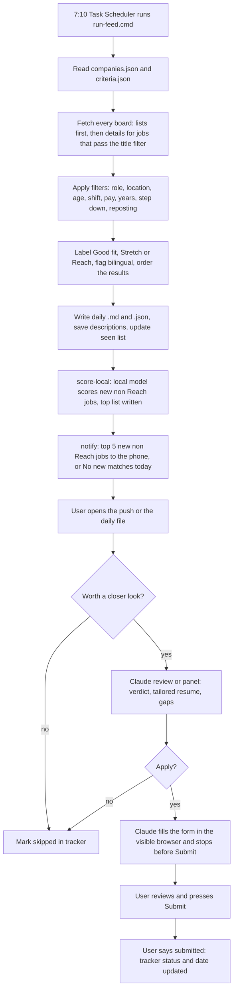

# Job Hunter: scope and design

Status: written 2026-11-18, describes what is built and running today. This file contains no personal data on purpose, so it can be shared.

## 1. What it is

Job Hunter is a personal job search assistant for one person looking for entry level security and IT operations roles. It does four jobs:

1. **Finds** new openings every morning, straight from employers' own career sites and from free public job APIs.
2. **Filters and labels** them against the user's rules (role, location, shift, pay, experience) and sorts them Good fit, Stretch or Reach.
3. **Prepares** applications: scores jobs with a model that runs on the user's own machine, tailors the resume without inventing anything, and fills application forms in a visible browser.
4. **Keeps a human in control.** A person reads every application and presses Submit. Nothing is ever sent for them.

It is one user, one machine, Windows. It is not a service.

## 2. What it does, end to end

| Capability | What happens | Where it lives |
|---|---|---|
| Sources | 84 enabled sources: 82 company boards and 2 aggregator APIs, read through adapters | `fetch-jobs.mjs`, `companies.json` |
| Filters | Drops jobs that do not fit the rules, flags the risky ones | `criteria.json`, `fetch-jobs.mjs` |
| Fit labels | Good fit, Stretch or Reach on every job | `criteria.json` (`fit`) |
| Local scoring | A local 7B model gives a first pass score 0 to 100 | `score-local.ps1` |
| Daily task | Runs the feed, scoring and push at 7:10 each morning | Windows Task Scheduler, `run-feed.cmd` |
| Phone push | Top 5 new jobs, or "No new matches today", through ntfy | `notify.ps1` |
| Review and fast lane | Claude reviews the top jobs and writes the Top 5 fresh with reach out cards | `PROMPT.md` Parts 1 and 5 |
| Resume panel | ATS check, recruiter skim, hiring manager review, tailored one page resume | `panel/`, `PROMPT.md` Part 6 |
| Application filling | Visible browser fills the form from a profile file, stops before Submit | Playwright, `profile.json`, `PROMPT.md` Part 2 |
| Tracker | One row per job from found to submitted | `tracker.csv` |
| Backups and log | Numbered backups before every change, a change log | `*.bakN`, `UPGRADE-LOG.md` |

### 2.1 Sources and adapters

Each adapter turns one kind of career site into the same job record (title, location, description, pay, posted date, link).

| Adapter | Boards | How it reads them | Notes |
|---|---|---|---|
| Greenhouse | 48 | public board JSON API | pay transparency fields when published |
| Ashby | 20 | public posting API | compensation summary when published |
| Lever | 6 | public postings API | salary range when published |
| Workday | 5 | each company's public search endpoint | see 2.1.1 |
| Paylocity | 2 | public job list page and detail pages | detail text from the page data |
| UltiPro (UKG) | 1 | public job board search endpoint | detail text from the page data |
| USAJobs | 1 | official API with a free key | IT Management series 2210, cybersecurity and SOC keywords, remote or near the home location |
| Remotive | 1 | public API | remote only, delayed 24 hours, at most 4 calls a day, links back to Remotive as their terms require |

Boards that cannot be read (HTML only, or no public list) are skipped on purpose and listed under known limits. Adding a company is one line in `companies.json`, then `node fetch-jobs.mjs --check` confirms it works.

#### 2.1.1 Workday and the Cloudflare challenge

Workday career sites sit behind Cloudflare. After a burst of requests they answer HTTP 429 with a bot challenge (`cf-mitigated: challenge`), and more requests only prolong the block. The feed handles this honestly:

- it keeps an honest user agent and never tries to look like a browser or get around the challenge;
- it sends few requests: one at a time, 6 seconds apart, a short list of search terms per board, and job detail pages only for jobs not checked in the last 14 days (at most 25 per run);
- on the first 429 it stops all Workday requests for that run, says so in the daily report, and tries again at the next run.

### 2.2 Filters

Applied to every job, in this order. Anything that fails is dropped and counted in the run summary.

1. **Role:** the title must match a target category (security, systems or network, IT support as a fallback) and must not match an exclude list (sales, software engineering, finance and similar) or a seniority list (senior, lead, manager, and so on).
2. **Location:** fully remote in the US first, then hybrid, then on site inside a radius of the home location. Remote jobs limited to other regions are dropped. The area is set in `criteria.json` (home point, radius, state, counties) and `places.json` (the towns around home), so anyone can point it at their own region.
3. **Age:** older than 60 days is dropped.
4. **Shift:** overnight and third shift are dropped. Flags are added for shifts that end after midnight, second shift, 24/7 or rotating schedules, on call, weekends and West Coast hours.
5. **Pay:** below the category floor is dropped. A listed pay that starts above the senior pay ceiling is dropped as a sign of a senior role. Pay not listed passes with a flag.
6. **Experience:** jobs asking for more than 3 years are dropped.
7. **Step down roles:** service desk and help desk Tier 1 roles are dropped unless the listed pay reaches a higher floor.
8. **Reposting:** the same title posted again on three or more different days inside 120 days is dropped.

Other flags raised from the posting text: clearance required or obtainable, citizenship required, certification mentioned, degree required, location limits in the text, internship, part time, contract, pay not listed.

### 2.3 Fit labels and ranking

Every job that survives gets one label, from rules in `criteria.json`:

- **Good fit:** Tier 1 and Analyst I style titles, Associate, Junior, MSSP or MDR roles, internships, NOC and systems administrator titles, and 0 to 2 years asked.
- **Stretch:** level II titles, detection analyst, 2 to 3 years asked, entry level security engineer titles, and jobs with no level or years listed.
- **Reach:** other engineer titles, required query language skills (KQL, SPL), or 4+ years.

Results are ordered by category (security first), then label, then a bilingual English and Spanish match, then location (remote, hybrid, on site). Reach jobs never reach the phone push, the Top 5 or local scoring. They sit in a collapsed "Reach (for later)" section at the bottom of the daily file.

### 2.4 Local scoring

`score-local.ps1` reads each new non Reach job and the resume text and asks a local model for a score from 0 to 100 and a one line reason. The model is a 7B model served on the same machine (through a small gateway), so the resume text never leaves it. A bilingual match adds 10 points. The output is `scores-latest.json` and a short list of the top jobs for Claude to review.

The score is a rough tiebreaker inside a label, not a verdict: the small model is noisy, so the final call is made in the Claude review.

### 2.5 Review, fast lane and reach out cards

When the user asks, Claude reads the top jobs, checks the employer rating from web search results, scores each against a written rubric (role fit, skills overlap, experience and education, logistics), and writes a shortlist. The fast lane covers jobs first seen in the last 48 hours: a Top 5 with, for each job, who to look for (team and title), a LinkedIn people search link that is built but never opened, and a short referral message draft under five lines. The user edits and sends it himself or herself. Nothing is sent by the tool.

### 2.6 Resume panel

Trigger: "panel company role", for Good fit and Stretch jobs. Steps:

1. **ATS check:** the local model lists the keywords in the posting (three passes, merged), then a script checks each one against the resume text, so the found and missing lists are exact. It also checks the text layer of the PDF: one page, name and contact at the top, plain headings, no broken characters.
2. **Recruiter skim:** three lines on title, years and fit, drafted locally and corrected.
3. **Hiring manager review:** strengths, weaknesses, and a verdict (apply or skip).
4. **Tailored resume:** an edited copy of the master `.docx`, reworded and reordered using the posting's terms, only for things that are true. `panel/facts-guard.py` rejects any new tool, certification, acronym, proper noun or number that is not in the resume or in a short list of confirmed facts. `panel/render-pdf.ps1` makes the PDF with LibreOffice and insists on one page.
5. **ATS check again** on the tailored PDF with the same keywords.
6. **Gaps:** real gaps are appended to `output/gaps.md`.

The master resume is never edited by the panel.

### 2.7 Application filling, with a human at Submit

A visible browser (Playwright with Edge) opens the application, fills it from `profile.json`, uploads the resume, and stops before the final button. It writes every answer to `output/applications/company-role.md` so the user can paste them into a normal browser if Submit fails. Rules it follows: never press Submit, Apply or Send; never create accounts, type passwords or handle login codes (the user signs in); never solve CAPTCHAs; never answer untruthfully to get past a filter; demographic questions use the user's saved choices (default: decline); salary questions get "Negotiable" unless a number is forced.

### 2.8 Tracker

`tracker.csv`: date found, company, title, link, score, label, rating, pay, flags, status, status date, notes, applied date, contact name, contact channel, note sent date, follow up date. Statuses: shortlisted, skipped, to apply, filled, submitted, interview, rejected, offer, closed. Rows are added when a job is reviewed and updated when the user reports a change.

### 2.9 Daily task and phone push

Windows Task Scheduler runs `run-feed.cmd` at 7:10 every morning:

1. `node fetch-jobs.mjs` (the feed),
2. `score-local.ps1` (local scoring of new jobs),
3. `notify.ps1 -Daily` (the push).

The push is sent through ntfy.sh to a random topic name. It contains only company, title, pay, label and link for the top 5 new non Reach jobs, or "No new matches today", or a warning if the feed did not run. No resume or personal data is in it. The log is `logs/feed.log`.

### 2.10 Backups and change control

Before any script, config, prompt or tracker is changed, a numbered `.bak` copy is made. Changes are tested on a scratch copy first, then copied over. Every change is written to `UPGRADE-LOG.md`. The "seen" lists that decide what counts as new are never edited by hand.

## 3. Architecture

## 4. Daily flow

## 5. What runs locally and what runs in the cloud

| Piece | Where | Data it sees |
|---|---|---|
| Feed, filters, labels, tracker, daily files | Local | public job postings only |
| Local scoring model | Local | resume text and postings, never leaves the machine |
| Resume editing, PDF rendering, facts guard | Local | resume and postings |
| Visible browser filling forms | Local | profile data, sent only to the employer's own application site |
| Secrets (push topic, API key) | Local, encrypted for one Windows user; passwords in a cloud password vault | never printed, never typed into the chat |
| Claude (review, panel, form filling) | Cloud | what is read into a session, including resume and profile when the user asks for applications |
| ntfy.sh push | Public cloud relay | company, title, pay, label, link. Protected only by an unguessable topic name |
| Public job APIs and career sites | Cloud | the tool's requests, with an honest user agent |

A second, free cloud model exists for generic writing, but it is never given resume, profile or any personal data.

## 6. Safety rules

1. **No scraping of LinkedIn, Indeed or ZipRecruiter.** Employer ratings come from web search result summaries, not from scraping those sites. LinkedIn is only used as a plain search link the user clicks himself or herself.
2. **A human presses Submit.** Always. The tool stops before the last step, never sends messages other than push notifications to the user, and never uses email finding tools or LinkedIn automation.
3. **No invented experience.** Written answers and tailored resumes use only facts from the resume and a short confirmed facts list. The facts guard enforces this for resumes. The tool never claims tools, certifications, numbers or employers that are not true.
4. **Secrets stay secret.** Passwords and master keys are never typed, asked for or printed. New secrets go into a password vault through a helper script. The push topic and the API key are stored encrypted with Windows DPAPI, readable only by that Windows user on that machine.
5. **Honest requests.** No evading bot protection, no fake browser headers, a stated limit on request volume, and each site's published API terms are followed.
6. **Private data stays local.** The resume and profile are scored only by the local model. Nothing personal goes into pushes.
7. **No surprises on the machine.** Deleting files in the project always asks first. Scheduled tasks are not changed without showing the plan.
8. **Client confidentiality.** Real incident stories can be used on private applications but client names are never written in any shared file.

## 7. Known limits

- **Supply, not logic, limits the number of Good fit jobs.** Only about one in nine matches is a Good fit, because most boards post mid and senior roles.
- **HTML only job systems are not read yet:** iCIMS, Dayforce, Phenom, Taleo, PeopleSoft, SuccessFactors, NEOGOV and similar. This leaves out many hospitals, universities, banks and public employers. They have to be checked by hand.
- **Workday depends on Cloudflare's mood.** A block means no Workday jobs that day. Nothing is retried within a run.
- **Pay is often not listed,** so pay rules cannot be applied to many jobs.
- **Years of experience are found with text patterns,** so an unusual phrasing can be missed or misread.
- **The local model is small and noisy.** Its scores only break ties.
- **The facts guard is a vocabulary check,** not a proof of truth. It catches new tools, certifications and numbers, not a changed meaning, so every tailored resume still needs a human read.
- **Application forms vary.** Custom dropdowns can fail to register, some sites need sign in, and some validation messages are confusing. Answers are saved so the user can paste them if needed.
- **Windows only.** PowerShell, DPAPI, Task Scheduler and a Windows path layout are assumed.
- **Single user, single machine.** There is no multi user mode and no cloud copy of the data.
- **A free public push relay** is the weakest link for privacy. The topic name is the only protection.

## 8. Roadmap

Near term
1. Watch the first runs of the paced Workday adapter. If it is still blocked or slow, move Workday into its own earlier scheduled task and merge its results into the 7:10 run.
2. Add adapters for HTML job systems (iCIMS, Dayforce, Phenom, NEOGOV, Taleo), starting with the employers that matter most.
3. Raise the Good fit share: more entry level and internship sources, and a rule for always open postings older than 60 days.
4. Tidy the project folder: move scratch notes and old backups out of the root.

Later
5. Calibrate scoring against outcomes: use the tracker (who replied, who interviewed) to check which labels and scores predicted a response.
6. A stronger local model for scoring and drafts when the hardware allows.
7. Follow up reminders from the tracker's follow up dates, sent as pushes.
8. Cover note and interview preparation drafts from the panel's gap list.
9. A weekly summary push: found, applied, replies, gaps that keep repeating.
10. A public, cleaned copy of the code and docs with example configuration, no personal data, and a short README.
11. Portability: example configs, Linux and macOS support for the scripts.
